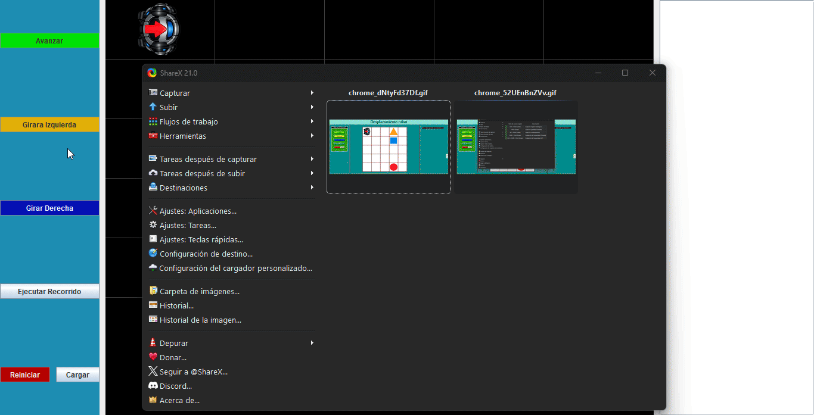

#  Simulador de Lógica Secuencial y Movimiento en Matriz


Aplicación de escritorio interactiva desarrollada en **Java** diseñada para introducir conceptos básicos de programación, pensamiento crítico y lógica secuencial mediante la simulación de recorrido de un agente en un tablero matricial.

> **Proyecto Académico** | Desarrollado para el curso de **Programación 1** (Facultad de Ingeniería, Universidad Mariano Gálvez de Guatemala).

---

## Vista Previa del Sistema

| Tablero Principal y Cola de Movimientos |
| :---: |
|  |

---

##  Características Principales

* **Tablero Matricial Dinámico:** Generación de un tablero grid con objetos aleatorios únicos en forma y color (círculos, cuadrados y triángulos) como obstáculos o metas.
* **Cola de Instrucciones (Área de Selección):** Permite apilar comandos secuenciales mediante botones interactivos:
  * **Avanzar:** Mueve al agente un cuadro hacia adelante.
  * **Girar Izquierda / Derecha:** Modifica la orientación espacial del agente.
* **Motor de Ejecución con Timer:** Animación secuencial del recorrido procesando los comandos almacenados.
* **Historial de Intentos (Función Cargar):** Panel flotante en memoria volátil para el registro de victorias, derrotas y marcas de tiempo durante la ejecución activa.
* **Manejo de Estados:** Detección automática de colisiones, límites del tablero y condiciones de victoria o derrota.

---

## Tecnologías y Conceptos Aplicados

* **Lenguaje:** Java (JDK 25).
* **Entorno de Desarrollo:** IntelliJ IDEA.
* **Lógica del Sistema (Backend / Core):**
  * **Estructuras de Datos:** Manejo de matrices bidimensionales ($X \times Y$) y colas de instrucciones (*Queue* / Listas).
  * **Programación Orientada a Objetos (POO):** Encapsulamiento, clases de entidad (`Figuras`, `App`, etc.) y manejo de eventos (`ActionListener`).
* **Interfaz Gráfica (GUI):**
  * Maquetado en **Java Swing / AWT** utilizando el diseñador visual de IntelliJ y componentes personalizados.

---

##  Origen del Proyecto y Rol en el Desarrollo

El proyecto nació a partir de un documento de requerimientos y prototipos (*mocks*) de interfaz proporcionados por la cátedra del curso.

* **Desarrollo de Lógica y Algoritmos (Mi Enfoque Principal):** Estuve a cargo de la arquitectura de clases, el flujo de ejecución del temporizador, la matriz de posiciones, la lógica de validación de límites/obstáculos y la manipulación de la cola de movimientos.
* **Asistencia de IA en GUI:** Dado que Java Swing no formaba parte del programa de estudios oficial, me apalanqué de herramientas de IA para agilizar el maquetado de los componentes visuales (`JFrame`, paneles y disposición de botones), enfocando mi esfuerzo principal en la integración de eventos con el *core* lógico de la aplicación.

---

##  Cómo Ejecutar el Proyecto

### Requisitos Previos
* Tener instalado **Java JDK 25** (o JDK 17+).
* Un IDE de Java (recomendado **IntelliJ IDEA**).

### Pasos
1. Clona este repositorio:
```bash
git clone https://github.com/canahuii/muevete_con_guali.git
```

2. Abre la carpeta del proyecto en IntelliJ IDEA.

3. Asegúrate de tener configurado el SDK de Java en las preferencias del proyecto.

4. Navega hasta el archivo src/App.java y ejecútalo (Run App.main()).
